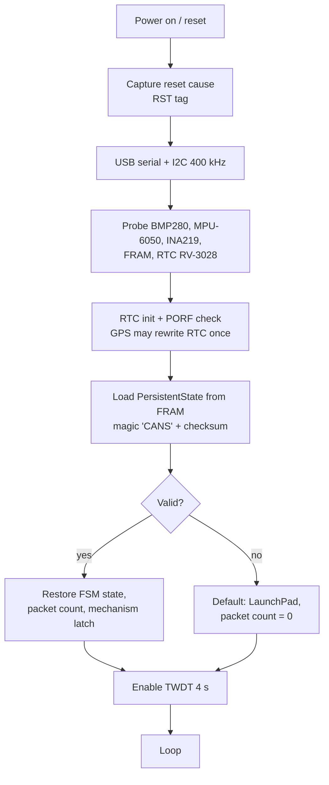
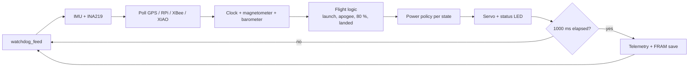
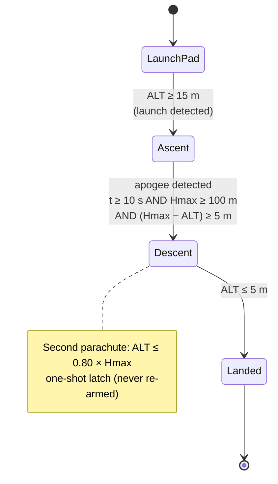

# Bloque de software de vuelo — PDR 2026/2027

Guía de armado de la parte de **Florencia González (ISI 1)** en la presentación PDR
del CanSat YVYSAT.

- Fecha: **2026-11-19**
- Fuente de contenido: el firmware real del OBC (`firmware/obc-esp32s3/`) y la
  documentación de `docs/03-subsistemas/software-vuelo/`.
- Fuente de estructura: `guia-armado-pdr-yvysat.pdf` (reparto de bloques) y
  `pdr-yvysat-v3.pdf` (deck actual).
- Los dos PDF **no se versionan** (están en `.gitignore`): pedilos al Drive del equipo.

---

## 1. Alcance: qué es tuyo y qué no

| Slide | Tema | Responsable | Estado en el deck v3 |
|---|---|---|---|
| **69** | FSW Overview | **Flor** | vacía (solo "Expectations") |
| **70** | Payload FSW State Diagram | **Flor** | vacía |
| **71** | Software Development Plan | **Flor** | vacía |
| **FSW-A** | Simulation Mode Software (adicional, no está en el template) | **Flor** | no existe |
| 57 | Discussion of Transmission Control | Juan (C&DH) | vacía |
| 58 | Payload Telemetry Format | Juan (C&DH) | vacía |
| 59 | Payload Command Formats | Juan (C&DH) | vacía |
| 60-68 | Electrical Power | Catriel | mayormente completa |
| 72-77 | Ground Control System | Agustín | vacía |

**Dato importante de numeración:** la guía llama 69-71 a tus slides, pero el pie de
página del PPTX muestra **66-68** (hay un desfase de 3). Ubicalas por **título**, no
por número.

**Contexto de puntaje:** Flight Software vale **8 puntos de 262 (3,1 %)**, pero varios
ítems del checklist de la guía son transversales (FSM con reinicios, Hmax, telemetría
1 Hz y activación automática) y también se evalúan en C&DH y Mission Operations. Una
slide 70 sólida te sirve para tres secciones.

---

## 2. Reglas para todas tus slides

1. **El deck está en inglés.** Títulos, bullets y diagramas en inglés; tu guion oral y
   estas notas en español.
2. **Diagrama antes que texto.** La guía del equipo lo pide explícitamente: la PDR debe
   dejar ver arquitectura e interfaces de un vistazo.
3. **Un mensaje por slide.** Si el jurado se lleva una sola idea de cada slide, ¿cuál es?
4. **Números con fuente.** Todo valor cuantitativo sale de `config.h`, del código o del
   build registrado. Nada estimado "a ojo".
5. **Cada "Expectations" del template se responde en la slide.** Copio el texto oficial
   en cada sección para que verifiques que no quedó nada sin contestar.
6. **No prometas lo que no está medido.** Si algo no se validó, se dice "definido y
   pendiente de banco", no "funciona".

### Cifras verificadas que podés usar con tranquilidad

| Dato | Valor | Fuente |
|---|---|---|
| Período de telemetría | 1000 ms (1 Hz) | `config.h` `kTelemetryPeriodMs` |
| Bus I²C | GPIO 8/9 a 400 kHz | `config.h` |
| GPS | GPIO 17/18, 9600 8N1 | `config.h` |
| XBee | GPIO 15/16, 115200 8N1 | `config.h` |
| Raspberry Pi | GPIO 14/13, 115200 8N1 | `config.h` |
| Watchdog (TWDT) | 4000 ms | `config.h` `kWatchdogTimeoutMs` |
| Altitud mínima de apogeo | 100 m | `config.h` `kMinApogeeAltitudeM` |
| Caída para declarar apogeo | 5 m | `config.h` `kApogeeDropM` |
| Umbral 2º paracaídas | 80 % de Hmax | `config.h` `kSecondParachuteRatio` |
| Tiempo mínimo de vuelo | 10 s | `config.h` `kMinFlightTimeMs` |
| Detección de lanzamiento | altitud ≥ 15 m | `main.cpp` `update_flight_logic` |
| Detección de aterrizaje | altitud ≤ 5 m en `Descent` | `main.cpp` |
| Rieles | 10 (5 base + 5 conmutables) | `flight_core/power.h` |
| Tests unitarios | 30 | `test/test_flight_core/` |
| Flash / RAM del build | 416 386 B (12,5 %) / 24 808 B (7,6 %) | build del 2026-11-16 |

---

## 3. Slide 69 — FSW Overview

> **Expectations del template:** "Should discuss basic FSW architecture including a
> flowchart showing the software flow, programming languages, development environments
> and a brief summary of the FSW tasks."

### 3.1 Qué tiene que quedar claro

Que el software está **partido en dos capas** por una razón concreta: la lógica de vuelo
se prueba sin hardware. Ese es el argumento fuerte de la slide.

### 3.2 Layout sugerido

- **Izquierda (55 %)**: diagrama de bloques de las dos capas + flujo de arranque.
- **Derecha (45 %)**: bullets de stack y de tareas.
- **Pie**: flash/RAM y cantidad de tests.

### 3.3 Texto de la slide (inglés, listo para copiar)

**Título:** `FSW Overview`
**Subtítulo:** `Layered flight software: portable logic + board layer`

```
STACK
· C++17 · Arduino-ESP32 3.3.12 · PlatformIO (platform-espressif32 8.0.0)
· Single deterministic superloop (no RTOS): fixed order, fixed 1 Hz telemetry

TWO LAYERS
· flight_core/  pure logic, zero Arduino calls → 30 unit tests on the host
· src/          hardware layer: I²C/UART drivers, GPIO, watchdog

MODULES
· Flight state machine          · Apogee + 80 % detector
· Sensor sampling              · Power policy (10 rails)
· Command parser               · Persistent state (FRAM)
· Telemetry (ASCII, 1 Hz)      · Mission clock (GPS > cmd > RTC > millis)
· Health monitor + status LED

ROBUSTNESS
· Task watchdog 4 s; reset cause published as RST:<tag>
· State survives resets: FRAM + RTC with CR1225 backup

FOOTPRINT  416 KB flash (12.5 %) · 24.8 KB RAM (7.6 %)
```

### 3.4 Diagrama de arranque (Mermaid, para redibujar en el template)



### 3.5 Una vuelta de `loop()` (si te preguntan "el flowchart del software")



### 3.6 Guion oral (≈90 s)

> "El software está dividido en dos capas a propósito. La capa `flight_core` es lógica
> pura: no llama a Arduino ni a ningún periférico, así que se puede compilar y probar en
> una PC. Hoy tiene 30 tests unitarios. La capa `src` es la que toca el hardware:
> drivers de I²C, las tres UART, los GPIO y el watchdog.
>
> El lazo es determinista y sin RTOS. En cada vuelta leemos IMU, corriente y barómetro,
> atendemos las tres UART, corremos la lógica de vuelo y aplicamos la política de
> energía. La telemetría sale exactamente a 1 Hz, que es lo que pide el reglamento.
>
> Para robustez hay dos mecanismos: un watchdog de 4 segundos que reinicia el OBC si el
> lazo se cuelga —y que deja registrada la causa en el campo RST de la telemetría— y el
> estado persistido en FRAM, que sobrevive a los reinicios.
>
> El binario ocupa 12,5 % de la flash y 7,6 % de la RAM del ESP32-S3."

### 3.7 Preguntas probables

| Pregunta | Respuesta corta |
|---|---|
| ¿Por qué no usan FreeRTOS? | Un lazo determinista de 1 Hz no necesita concurrencia; evitamos condiciones de carrera y el costo de sincronizar tareas. El watchdog cubre el caso de cuelgue. |
| ¿Por qué C++ y no MicroPython? | Necesitamos control de tiempo y de memoria predecible, y acceso a I²C/UART con latencia acotada. Además la lógica pura se testea en host. |
| ¿Qué pasa si se reinicia en vuelo? | Restaura estado desde FRAM (estado de la FSM, contador de paquetes y latch del mecanismo) y sigue publicando; la telemetría informa la causa con `RST`. |
| ¿Cuánto tarda en arrancar? | El OBC arranca en menos de 1 s; los periféricos que cuelgan de rieles conmutados (cámaras XIAO) tienen 4 s de ventana antes de re-sondear. |

### 3.8 Evidencia de respaldo

- `firmware/obc-esp32s3/include/config.h` — constantes.
- `firmware/obc-esp32s3/src/main.cpp` — `setup()`, `loop()`, `watchdog`.
- `firmware/obc-esp32s3/lib/flight_core/` — módulos puros.
- `docs/03-subsistemas/software-vuelo/indicadores-v2.md` — watchdog y `RST`.

---

## 4. Slide 70 — Payload FSW State Diagram

> **Expectations del template:** "Software state diagrams for payload defining the states
> and transition conditions of the flight software. Also include sampling of sensors with
> rates, communications, data storage, mechanism activations, major decision points in
> the logic and power management. Should also include FSW recovery to correct state after
> processor reset during flight."

Es la slide más importante de tu bloque: acá se juegan casi todos los ítems del
checklist. El template pide **siete** cosas; conviene que la slide las muestre las siete,
aunque sea en tablas chicas alrededor del diagrama.

### 4.1 Layout sugerido

- **Centro (55 %)**: diagrama de estados con las tres condiciones numéricas.
- **Arriba derecha**: tabla de transiciones.
- **Abajo derecha**: dos tablas compactas — "rates" y "recovery".
- **Pie**: nota de power management por estado.

### 4.2 Diagrama de estados



### 4.3 Tabla de transiciones (va en la slide)

| From → To | Condition | Action |
|---|---|---|
| LaunchPad → Ascent | `ALT ≥ 15 m` | XIAO start capture; broadcast `CMD:MISSION_START;STATE:Ascent` on USB, XBee and RPi (req. X3) |
| Ascent → Descent | `t ≥ 10 s` **and** `Hmax ≥ 100 m` **and** `(Hmax − ALT) ≥ 5 m` | XIAO capture at apogee; latch `apogee_detected` |
| Descent → 2nd parachute | `ALT ≤ 0.80 × Hmax` | Servo to 90°; latch `second_parachute_deployed`; XIAO capture |
| Descent → Landed | `ALT ≤ 5 m` | Stop capture; payload power off |

Los tres umbrales del apogeo están pensados como **guardas**: los 10 s descartan ruido
del lanzamiento, los 100 m descartan un vuelo que no despegó, y los 5 m de caída evitan
declarar apogeo por una fluctuación del barómetro.

### 4.4 Tasas de muestreo (el template las pide explícitamente)

| Dato | Cómo se obtiene | Tasa |
|---|---|---|
| Telemetría | paquete ASCII | **1 Hz exacto** (`kTelemetryPeriodMs = 1000`) |
| IMU MPU-6050 (accel + gyro) | lectura I²C en cada vuelta del lazo | continua, sin tasa fija publicada ⚠️ |
| Barómetro BMP280 (altitud) | lectura I²C en cada vuelta del lazo | continua, sin tasa fija publicada ⚠️ |
| Corriente/tensión INA219 | lectura I²C en cada vuelta | continua |
| GNSS NEO-M8N | NMEA por UART a 9600 8N1 | según fix del receptor (típico 1–5 Hz) |
| Magnetómetro LIS3MDL + ópticos | lectura I²C en cada vuelta | continua |
| Comandos | polling de USB, XBee y RPi | en cada vuelta |

> ⚠️ **Pendiente real (ver §8):** la frecuencia efectiva del lazo no se midió en banco.
> Si el jurado pregunta "¿a qué frecuencia muestrean?", la respuesta honesta es: "la
> lectura es continua y la telemetría se publica a 1 Hz; la tasa del lazo se mide en el
> ensayo de banco". **No inventes un número.**

### 4.5 Comunicaciones, almacenamiento y mecanismo (una línea cada uno en la slide)

```
COMMUNICATIONS
· 3 independent links: USB CDC (console) · XBee-PRO 900HP (radio, 1 Hz) · UART to RPi
· Commands: CX (status) · ST (set time) · CAL (zero altitude) · MEC (release)
            RPI / RPIOFF (payload power) · RST (reset FSM)

DATA STORAGE
· FRAM MB85RC256V, magic 'CANS' + version + checksum
· Persists: FSM state · packet count · mission time · altitude offset ·
            armed · second_parachute_deployed
· Written at 1 Hz and immediately on CAL / MEC

MECHANISM
· Servo SG90 to 90° at 80 % of Hmax
· One-shot latch in RAM and FRAM: never re-armed after deployment
```

### 4.6 Power management por estado (tabla chica, abajo)

| State | Rails ON |
|---|---|
| `LaunchPad` | base: RTC, FRAM, sensors, GPS, radio |
| `Ascent` / `Descent` | base + RPi + 2× XIAO + servo + secondary mission |
| `Landed` | base only (payload off to save battery) |
| Command `RPI` | adds payload in any state except `Landed` |

Son 10 rieles: 5 base sin GPIO de habilitación y 5 conmutables (`EN_RPI` 11,
`EN_CENIT` 12, `EN_NADIR` 38, `EN_SERVO` 39, `EN_SEC` 40).

### 4.7 Recovery after reset (el template lo pide aparte)

```
On boot: FRAM is read before enabling the watchdog.
· Valid record (magic + checksum) → restore state, packet count, mechanism latch
· Invalid record → start in LaunchPad with packet count 0
· RST:<tag> in every telemetry frame tells why the OBC restarted
```

### 4.8 Guion oral (≈2 min)

> "La lógica de vuelo es una máquina de cuatro estados. Arranca en `LaunchPad` y pasa a
> `Ascent` cuando la altitud supera los 15 metros —ese es el evento de lanzamiento, y en
> ese momento el OBC manda automáticamente el comando de inicio de misión por los tres
> enlaces, que es lo que pide el requisito X3—.
>
> El apogeo no se declara con un solo umbral: exigimos al menos 10 segundos de vuelo, una
> altura máxima de al menos 100 metros y una caída de 5 metros desde el máximo. Esas tres
> guardas evitan que el ruido del lanzamiento o una fluctuación del barómetro disparen el
> descenso antes de tiempo.
>
> El segundo paracaídas se libera al 80 % de la altura máxima, con un latch de un solo
> disparo: una vez desplegado, ningún reinicio ni ninguna lectura posterior lo vuelve a
> armar. Eso está persistido en FRAM, así que sobrevive a un reset en vuelo.
>
> El aterrizaje se detecta a 5 metros en descenso. Ahí apagamos la carga útil para ahorrar
> batería y dejamos la telemetría corriendo.
>
> La telemetría se publica a 1 Hz y cada paquete se persiste en FRAM junto con el estado de
> la máquina y el contador de paquetes. Si el OBC se reinicia, al arrancar lee la FRAM
> antes de habilitar el watchdog y retoma el estado correcto. La causa del reinicio queda
> en el campo RST."

### 4.9 Preguntas probables

| Pregunta | Respuesta corta |
|---|---|
| ¿Por qué 80 % y no el apogeo para el segundo paracaídas? | Porque el primero ya frena el descenso; el segundo entra cuando la velocidad se estabilizó y la altura restante garantiza el tiempo de apertura (requisito C4: 5 ± 3 m/s). |
| ¿Qué pasa si el barómetro falla? | Es el único sensor crítico: el sistema pasa a severidad `Fault` (LED de falla a 1 Hz). Sin altitud no hay detección de apogeo confiable. |
| ¿Cómo evitan que el mecanismo se active dos veces? | Doble latch: en RAM y en FRAM (`second_parachute_deployed`). Al restaurar, si ya está en 1 el servo no se vuelve a comandar. |
| ¿Y si se reinicia justo durante el ascenso? | La FSM se restaura desde FRAM con el estado guardado y el contador de paquetes; el `RST` de la telemetría lo delata. |
| ¿El contador de paquetes vuelve a cero? | No: se incrementa en cada trama y se persiste, así la GCS detecta huecos. |
| ¿Muestrean a 1 Hz? | La telemetría sí. Los sensores se leen en cada vuelta del lazo; la tasa exacta se mide en banco. |

### 4.10 Evidencia de respaldo

- `lib/flight_core/include/flight_core/fsm.h` — estados y eventos.
- `lib/flight_core/src/flight.cpp` — umbrales de apogeo y 80 %.
- `lib/flight_core/include/flight_core/storage.h` — `PersistentState`.
- `lib/flight_core/src/power.cpp` — rieles por estado.
- `src/main.cpp` — `update_flight_logic()`, `apply_power_policy()`, `persist_state()`.

---

## 5. Slide 71 — Software Development Plan

> **Expectations del template:** "The software development plan should include
> prototyping, software subsystem development sequence, development team and test
> methodology."

### 5.1 Layout sugerido

- **Izquierda (50 %)**: línea de tiempo de prototipos P0 → P3.
- **Derecha (50 %)**: tabla de metodología de pruebas con criterio de aceptación.
- **Pie**: equipo y herramientas.

### 5.2 Texto de la slide (inglés)

**Título:** `Software Development Plan`

```
SEQUENCE
P0  Pure logic + unit tests on host        [done]
P1  Hardware layer on bench: I²C, UARTs,
    3 rails, watchdog, FRAM/RTC            [next]
P2  Integrated test: full telemetry chain
    OBC → XBee → GCS at 1 Hz               [next]
P3  Flight-like: simulated profile +
    drop test with descent systems         [integration]

TEAM                    TOOLS
FSW: Florencia González PlatformIO · Arduino-ESP32 3.3.12
GCS: Agustín Brites     Unity (native tests) · pytest (GCS)
Payload: cross-review   Wokwi (simulation)

TEST METHODOLOGY
· Unit (host): 30 tests over pure logic — thresholds, time algorithm,
  persistence, power policy, command parser
· Integration (bench): sensor presence, link loopback, watchdog reset
· Simulation: CANSAT_SIMULATION injects altitude/acceleration profiles
· Acceptance: every test declares input, method and pass condition
```

### 5.3 Criterios de aceptación (si preguntan "¿cómo saben que funciona?")

| Nivel | Prueba | Criterio |
|---|---|---|
| Unidad | 30 tests de lógica pura | 30/30 en verde en el entorno `native` |
| Banco | presencia de sensores en I²C | los 5 dispositivos responden en su dirección |
| Banco | las 3 UART | loopback y eco de comandos en cada enlace |
| Banco | watchdog | cuelgue inducido → reinicio y `RST:W` en telemetría |
| Sistema | cadena de telemetría | 1 paquete/s sostenido durante 30 min sin huecos |
| Vuelo | perfil simulado | FSM recorre los 4 estados en el orden esperado |

### 5.4 Guion oral (≈70 s)

> "El desarrollo va por prototipos. El P0 es la lógica pura con tests en la PC: ahí
> validamos umbrales, algoritmo de tiempo, persistencia y política de energía sin
> hardware. El P1 es la capa de hardware en banco: I²C, las tres UART, las llaves de
> alimentación, el watchdog y la FRAM. El P2 integra la cadena completa hasta la estación
> terrena a 1 Hz. El P3 es el ensayo tipo vuelo, con perfil simulado y prueba de caída
> junto con el equipo de descenso.
>
> La metodología es la misma en todos los niveles: cada prueba declara entrada, método y
> condición de aprobación. No decimos 'se probará': decimos qué se mide y a partir de qué
> valor se considera aprobado.
>
> Hoy el P0 está completo y el build verificado; el P1 es el próximo paso y depende del
> arnés de alimentación."

### 5.5 Preguntas probables

| Pregunta | Respuesta corta |
|---|---|
| ¿Los 30 tests pasan? | Están definidos y registrados; la ejecución en host es parte del P1 (requiere compilador de host, que el entorno de desarrollo actual no tiene). El build del firmware sí está verificado. |
| ¿Por qué no hay CI? | El repo es privado y sin runner; el plan es correr `pio test -e native` y el build en cada PR cuando el entorno de banco esté armado. |
| ¿Quién revisa el código? | Cross-review del equipo; las PR necesitan al menos una revisión de otro integrante (regla del repo). |
| ¿Cómo versionan? | Git, rama `main` protegida por revisión, commits con formato `tipo(area): descripción`. |

### 5.6 Evidencia de respaldo

- `firmware/obc-esp32s3/test/test_flight_core/test_flight_core.cpp` — 30 tests.
- `firmware/obc-esp32s3/platformio.ini` — entornos `obc`, `native`, `sim`.
- `docs/05-pdr/README.md` — checklist de evidencias por subsistema.

---

## 6. Slide FSW-A — Simulation Mode Software (adicional)

La Scoresheet evalúa este criterio y **no tiene slide en el template**. La guía la numera
`FSW-A`. Va después de la 71.

### 6.1 Texto de la slide (inglés)

**Título:** `Simulation Mode Software`

```
PURPOSE
Validate the flight logic without flight hardware.

HOW IT WORKS
· Separate PlatformIO environment: env:sim with -D CANSAT_SIMULATION=1
· Injectors replace the sensor layer, not the flight logic:
  – synthetic NMEA (GGA + RMC) with configurable time and position
  – altitude and acceleration profiles (ascent, apogee, descent, landing)
  – fixed INA219 readings; no power-rail dependency
· The same FSM, apogee detector, storage and telemetry code runs

WHAT IT PROVES
· 4-state sequence and transition order
· 80 % trigger fires exactly once
· packet count continuity and FRAM restore
· telemetry format identical to flight

WHAT IT DOES NOT PROVE
· real sensor noise, timing jitter and power behaviour → bench test
```

### 6.2 Guion oral (≈40 s)

> "El modo simulación reemplaza la capa de sensores, no la lógica. Se compila en un
> entorno aparte con `CANSAT_SIMULATION`, e inyecta tramas NMEA sintéticas y perfiles de
> altitud y aceleración. La máquina de estados, el detector de apogeo, la persistencia y
> la telemetría son exactamente el mismo código que vuela. Eso nos permite verificar la
> secuencia de estados y que el 80 % dispare una sola vez sin esperar a tener el hardware
> integrado. Lo que no prueba es el ruido real de los sensores ni el comportamiento
> eléctrico: eso queda para banco."

### 6.3 Estado real (importante)

La simulación Wokwi que existe en el repo es de la **arquitectura v3** y está archivada
como evidencia histórica (`docs/03-subsistemas/software-vuelo/archivo/`). El entorno
`env:sim` sigue declarado en `platformio.ini`. Si el jurado pregunta por capturas,
mostrá la evidencia archivada **aclarando que es de la versión anterior del circuito**.

---

## 7. Matriz criterio → slide → evidencia → estado

| Criterio (Scoresheet / checklist) | Slide | Evidencia | Estado |
|---|---|---|---|
| FSW architecture + flowchart | 69 | `main.cpp`, Mermaid de §3.4 | ✅ listo para armar |
| Programming language / environment | 69 | `platformio.ini`, C++17 | ✅ |
| Summary of FSW tasks | 69 | módulos de `flight_core` | ✅ |
| State diagram with conditions | 70 | `fsm.h`, `flight.cpp` | ✅ |
| Sampling rates | 70 | `config.h` + **medición pendiente** | ⚠️ falta medir |
| Communications | 70 | 3 UART + comandos | ✅ |
| Data storage | 70 | `storage.h` (FRAM) | ✅ |
| Mechanism activation | 70 | latch doble + servo | ✅ |
| Major decision points | 70 | umbrales 15/100/5/80 % | ✅ |
| Power management | 70 | `power.cpp` | ✅ |
| Recovery after reset | 70 | `PersistentState` + `RST` | ✅ |
| Prototyping + sequence | 71 | este documento §5 | ✅ |
| Development team | 71 | reparto del equipo | ✅ |
| Test methodology + acceptance | 71 | 30 tests + criterios §5.3 | ✅ |
| Hmax persistence | 70 | **no está en `PersistentState`** | ⚠️ ver §8 |
| Automatic telemetry after separation | 57 / 70 | broadcast en detección de lanzamiento | ⚠️ coordinar con Juan |
| Simulation mode | FSW-A | `env:sim` | ✅ con salvedad v3 |

---

## 8. Pendientes antes de presentar

Tres huecos reales. No los tapes: resolvelos o reconocelos en la slide.

1. **Tasa de muestreo del lazo (slide 70).** El template pide tasas. Hoy hay 1 Hz de
   telemetría publicado, pero la frecuencia del lazo no está medida. Opciones:
   - medirla en banco con un contador en `loop()` (10 minutos de trabajo), o
   - decir "lectura continua, telemetría a 1 Hz" y dejar la medición como parte del P1.
   **No inventes 10 Hz ni 50 Hz.**

2. **Hmax no se persiste (slide 70).** El checklist pide que el FSM contemple Hmax tras un
   reinicio. `PersistentState` guarda estado, contador de paquetes, tiempo de misión,
   offset de altitud, `armed` y `second_parachute_deployed` — pero **no** la altura máxima.
   Consecuencia: tras un reset en vuelo, el campo `MAX:` de telemetría se reinicia. El
   latch del mecanismo sí sobrevive, así que la seguridad no está comprometida.
   - Opción A: agregar `max_altitude_m` a `PersistentState` (cambio chico, rompe el
     formato del registro → subir `kPersistentVersion`).
   - Opción B: presentarlo como está y aclarar que el latch es lo que protege.

3. **"Activación automática tras separación" (slide 57, de Juan).** El código emite
   `CMD:MISSION_START;STATE:Ascent` al detectar lanzamiento (altitud ≥ 15 m), no al
   separarse del cohete. Si el requisito se lee literal, hay que coordinar con Juan si la
   slide 57 lo declara como "inicio de misión" o si hay que esperar un evento de
   separación. **No lo resuelvas en tu slide sin hablarlo**: es su bloque.

---

## 9. Fuera de alcance (para no pisar a nadie)

- **57-59** — transmisión, formato de telemetría y comandos: Juan López. Vos aportás el
  formato ASCII y la tabla de comandos si te los pide, pero no los presentás.
- **60-68** — eléctrico: Catriel Paz.
- **72-77** — estación terrena: Agustín Brites.
- **18-34** — sensores y trades: Juan López.

Interfaces que sí podés mencionar de pasada: la telemetría sale a 1 Hz por XBee (C&DH),
el consumo por estado lo calcula el EPS y la GCS decodifica el CSV de 33 columnas.

---

## 10. Fuentes

- `firmware/obc-esp32s3/include/config.h` — todas las constantes citadas.
- `firmware/obc-esp32s3/src/main.cpp` — lazo, FSM, comandos, telemetría.
- `firmware/obc-esp32s3/lib/flight_core/` — lógica pura.
- `docs/03-subsistemas/software-vuelo/` — `power-gating-v2.md`, `tiempo-mision-v2.md`,
  `indicadores-v2.md`.
- `docs/02-arquitectura/correcciones-conexionado-y-estado-firmware-v2.md` — estado del
  código y checklist de integración.
- `guia-armado-pdr-yvysat.pdf` y `pdr-yvysat-v3.pdf` — no versionados, en el Drive.
